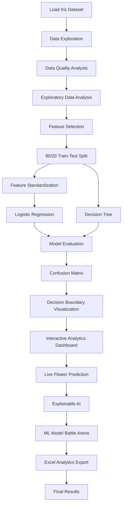

<div align="center">

# 🌸 IrisVision AI
### Intelligent ML Classification & Analytics System

**Explore Data • Predict Species • Explain Intelligence**

An interactive, end-to-end Machine Learning project transforming flower measurements into intelligent predictions, meaningful insights, and explainable decisions.


**Data Science & Machine Learning Internship Project**

*Built with Python | Powered by Machine Learning | Developed by Rohan Bhowmik*

</div>

---


## 🌟 About IrisVision AI

**IrisVision AI** is an intelligent, interactive Machine Learning classification and analytics system developed as part of my **Data Science and Machine Learning Internship**.

Unlike traditional classification projects that focus only on model accuracy, IrisVision AI goes further by combining **exploratory data analysis, real-time predictions, Explainable AI, automated data quality analysis, interactive dashboards, and model benchmarking** into one integrated Jupyter Notebook.

The system classifies Iris flowers into three species:

-  Iris Setosa
-  Iris Versicolor
-  Iris Virginica

Using four numerical flower measurements, the system learns patterns, predicts species, and provides visual insights into how Machine Learning algorithms make decisions.

>  **Project Vision:** Machine Learning should not just predict outcomes — it should help users explore, understand, compare, and explain them.

---

## 🌐 GitHub Repository

<div align="center">

### 🌸 Explore IrisVision AI

**Experience Intelligent Machine Learning, Interactive Analytics & Explainable AI.**

Explore the complete IrisVision AI project, including interactive data visualizations, live flower predictions, ML model benchmarking, and intelligent data analysis.

<br>

[](https://github.com/rohanbhowm25308/IrisVision-AI)

<br>

</div>

---


## 🚀 Key Features

###  1. Interactive Data Science Dashboard

An interactive analytics environment for exploring the Iris dataset.

**Capabilities:**
- Interactive Plotly visualizations
- Species-based data filtering
- Feature relationship exploration
- Dynamic scatter plots
- Data distribution analysis
- Visual exploration of flower measurements

**Purpose:** Transform raw data into meaningful and understandable visual insights.

###  2. Live Iris Flower Prediction System

An interactive prediction system that allows users to enter flower measurements and receive Machine Learning predictions.

**Input Parameters:**
- Sepal Length
- Sepal Width
- Petal Length
- Petal Width

**Prediction Output:**
- Predicted Iris species
- Classification probabilities
- Model selection
- Visual confidence comparison

The system uses trained Machine Learning classifiers to predict the flower species.

###  3. Explainable AI (XAI)

A Machine Learning explanation system designed to improve model interpretability.

**Capabilities:**
- Feature importance analysis
- Permutation importance visualization
- Identification of influential flower measurements
- Model interpretation
- Comparative feature analysis

**Purpose:** Understand which features contribute most to predictive performance.

###  4. ML Model Battle Arena

A benchmarking environment that compares two classification algorithms.

**Algorithms:**
1. Logistic Regression
2. Decision Tree Classifier

**Comparison Metrics:**
- Accuracy
- Precision
- Recall
- F1-Score
- Cross-validation performance
- Execution time

The arena helps identify differences in predictive performance and computational behavior.

###  5. Intelligent Data Quality Analyzer

An automated data inspection system that evaluates dataset quality before and during Machine Learning analysis.

**Capabilities:**
- Missing value detection
- Duplicate record analysis
- Class distribution inspection
- Potential outlier detection
- Isolation Forest anomaly analysis
- Data quality summaries

**Purpose:** Support reliable Machine Learning by identifying potential data quality issues.

###  6. Automated Excel Analytics Reporting

The project supports exporting analysis and Machine Learning results into an Excel workbook.

**Report Contents:**
- Iris dataset records
- Model evaluation metrics
- Prediction results
- Cross-validation results
- Data quality analysis
- Feature importance analysis

This makes results easier to review, document, and share.

---

##  Dataset Information

The project uses the publicly available **Iris Flower Dataset**.

**Dataset Source:**

https://raw.githubusercontent.com/mwaskom/seaborn-data/master/iris.csv

| Attribute | Details |
|---|---|
| Dataset | Iris Flower Dataset |
| Total Samples | 150 |
| Input Features | 4 |
| Target Variable | Species |
| Number of Classes | 3 |
| Problem Type | Multi-Class Classification |
| Data Format | CSV |

### Dataset Features

| Feature | Description |
|---|---|
| Sepal Length | Length of the flower's sepal |
| Sepal Width | Width of the flower's sepal |
| Petal Length | Length of the flower's petal |
| Petal Width | Width of the flower's petal |
| Species | Target flower category |

All four numerical measurements are expressed in centimeters.

---

##  Machine Learning Workflow



---

##  Technology Stack

| Category | Technologies |
|---|---|
| Programming Language | Python |
| Development Environment | Jupyter Notebook |
| Data Manipulation | Pandas, NumPy |
| Machine Learning | Scikit-learn |
| Data Visualization | Matplotlib, Seaborn |
| Interactive Visualization | Plotly |
| Interactive Controls | ipywidgets |
| Reporting | Excel, openpyxl |
| Model Evaluation | Scikit-learn Metrics |

---

##  Machine Learning Algorithms

### Logistic Regression

Logistic Regression is used as a supervised classification algorithm for predicting Iris flower species.

**Key Characteristics:**
- Supports multi-class classification
- Uses standardized numerical features
- Produces class probabilities
- Provides an interpretable classification baseline

### Decision Tree Classifier

Decision Tree is used as an alternative classification algorithm.

**Key Characteristics:**
- Learns rule-based decision structures
- Captures nonlinear feature relationships
- Supports feature importance analysis
- Provides interpretable decision rules

Both models are evaluated to understand their performance differences.

---

##  Model Evaluation

The project evaluates classification performance using:

**Accuracy**

Measures the proportion of correctly classified samples.

**Precision**

Measures how many predicted class assignments are correct.

**Recall**

Measures how effectively the model identifies actual class members.

**F1-Score**

Combines precision and recall into a single evaluation metric.

**Confusion Matrix**

Visualizes correct and incorrect classifications across the three Iris species.

**Cross-Validation**

Uses five-fold cross-validation to provide an additional assessment of model performance.

**Decision Boundaries**

Visualizes classification regions using separately trained two-feature models.

---

##  Exploratory Data Analysis

The project includes visualizations designed to explore relationships within the Iris dataset.

**Visualizations include:**
- Species distribution charts
- Feature histograms
- Pairplots
- Correlation heatmaps
- Scatter plots
- Boxplots
- Interactive feature comparisons

These visualizations help identify patterns, relationships, and differences among Iris species.

---

##  Installation and Setup

### Step 1: Clone the Repository

```bash
git clone https://github.com/rohanbhowm25308/IrisVision_AI.git
```

### Step 2: Open the Project Directory

```bash
cd IrisVision_AI
```

### Step 3: Install Required Libraries

```bash
python -m pip install -r requirements.txt
```

### Step 4: Launch Jupyter Notebook

```bash
jupyter notebook
```

### Step 5: Open the Project

Open:

`IrisVision_AI.ipynb`

Make sure `iris.csv` is available in the same directory.

### Step 6: Execute the Notebook

Select:

**Kernel → Restart & Run All**

The notebook will execute the Machine Learning pipeline and generate the available visualizations and reports.

---

##  How to Use IrisVision AI

### Interactive Dashboard

Explore flower measurements, filter species, and analyze feature relationships.

### Live Prediction

Enter flower measurements, select a classifier, and generate a species prediction.

### Explainable AI

Explore feature importance visualizations to understand model behavior.

### Model Battle Arena

Compare Logistic Regression and Decision Tree using evaluation metrics and cross-validation.

### Data Quality Analyzer

Inspect dataset quality, missing values, duplicates, and potential anomalies.

### Excel Export

Run the reporting section to export analysis and prediction results into Excel.

---

##  Project Objectives

The primary objectives of IrisVision AI are:

1. Develop an end-to-end Machine Learning classification pipeline.
2. Explore and understand the Iris dataset.
3. Implement multiple supervised learning algorithms.
4. Compare classification performance.
5. Build interactive data visualizations.
6. Provide real-time flower classification.
7. Improve model transparency through Explainable AI.
8. Analyze dataset quality and potential anomalies.
9. Generate structured Excel analytics reports.
10. Demonstrate practical Data Science and Machine Learning skills.

---

##  What Makes IrisVision AI Different?

IrisVision AI extends beyond a conventional classification notebook.

It integrates multiple important aspects of real-world Data Science into one project:

- **Analytics:** Understanding the dataset through interactive exploration.
- **Prediction:** Applying trained classifiers to new inputs.
- **Explainability:** Understanding model behavior and feature importance.
- **Benchmarking:** Comparing algorithms using multiple evaluation metrics.
- **Data Quality:** Identifying potential issues in the dataset.
- **Reporting:** Exporting structured results for further analysis.

This integrated approach makes the project useful for learning, experimentation, and technical demonstration.

---


These enhancements could extend IrisVision AI into a broader Machine Learning application.

---

## 👨‍💻 About the Developer

<div align="center">

### Rohan Bhowmik

**AI/ML | Data Science | Generative AI | AI Agents | Web Development**

Passionate about building intelligent systems, practical Machine Learning solutions, interactive analytics applications, and AI-powered technologies.

[](https://github.com/rohanbhowm25308)
[](https://www.linkedin.com/in/rohan-bhowmik-b014473a1)

</div>

---

## ⭐ Support the Project

If you find IrisVision AI interesting or useful:

- Give the repository a ⭐ star.
- Explore the Jupyter Notebook.
- Experiment with the Machine Learning models.
- Share suggestions for future improvements.

---

<div align="center">

# 🌸 IrisVision AI

### Explore. Predict. Explain.

**Turning Data into Intelligence, One Prediction at a Time.**

*Built with Python • Powered by Machine Learning • Developed by Rohan Bhowmik*

</div>
