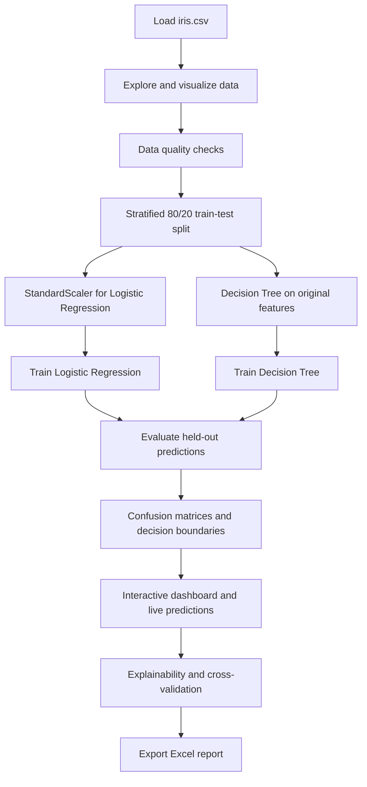

🌸 IrisVision AI
Intelligent ML Classification & Analytics System
From flower measurements to explainable predictions — a complete, interactive machine learning workflow in Jupyter Notebook.

Features · Workflow · Getting Started · Results · Author

✨ About the project
IrisVision AI is an end-to-end, multi-class flower classification project developed as part of a Data Science & Machine Learning internship. Rather than stopping at model training, it combines exploratory analysis, interactive visualizations, live predictions, explainability, model benchmarking, and Excel reporting in one reproducible notebook.

The system learns to distinguish three Iris species — Setosa, Versicolor, and Virginica — using four flower measurements.
Project philosophy: Don't just predict a class. Explore the data, understand the model, and explain the result.

🚀 Signature features
Feature	What it does
📊 Interactive Data Science Dashboard	Explore species and feature relationships using Plotly charts and Jupyter widgets.
🌺 Live Flower Prediction	Enter sepal and petal measurements, choose a trained classifier, and view predicted species and class probabilities.
🧠 Explainable AI (XAI)	Inspect permutation feature importance for both models to understand which measurements influence predictive performance.
⚔️ ML Model Battle Arena	Compare Logistic Regression and Decision Tree using held-out metrics, 5-fold cross-validation, and execution timing.
🔍 Intelligent Data Quality Analyzer	Inspect missing values, duplicates, class distribution, and potential outliers; use Isolation Forest for anomaly flags.
📁 Excel Analytics Export	Export dataset records, predictions, model results, and supporting analysis to a multi-sheet .xlsx workbook.

🧬 Dataset
Source: Seaborn Iris CSV
Attribute	Description
Samples	150
Input features	4 numerical measurements
Target	species
Classes	setosa, versicolor, virginica
Task	Supervised multi-class classification

Input columns: sepal_length, sepal_width, petal_length, petal_width (measurements in centimeters).
🔬 Machine learning workflow

Evaluation: accuracy, weighted precision, weighted recall, weighted F1-score, classification reports, confusion matrices, and 2D decision-boundary visualizations. A stratified 5-fold cross-validation comparison provides an additional performance check.

Preprocessing note: StandardScaler is fitted only on the training set to avoid test-data leakage. The Decision Tree uses the unscaled feature values.
📂 Repository structure
IrisVision_AI/
├── IrisVision_AI.ipynb         # Full notebook: original steps + advanced features
├── iris.csv                    # Input dataset
├── IrisVision_AI_Results.xlsx  # Generated Excel analytics report
├── requirements.txt            # Python dependencies
└── README.md                   # Project documentation
If you keep another Excel workbook containing distinct final analysis, you can add it separately; otherwise, one results workbook is sufficient.
⚙️ Getting started
1. Clone the repository
git clone https://github.com/rohanbhowm25308/IrisVision_AI.git
cd IrisVision_AI
2. Install dependencies
python -m pip install -r requirements.txt
3. Launch Jupyter Notebook
jupyter notebook
Open IrisVision_AI.ipynb, then choose Kernel → Restart & Run All. Keep iris.csv beside the notebook so its relative path resolves correctly.

4. Try the interactive features
- Filter species and select measurements in the dashboard.
- Adjust flower measurements and use the prediction widget.
- Review feature-importance charts and model comparisons.
- Run the Excel export cell to create or update IrisVision_AI_Results.xlsx.
Widget tip: If the interactive controls do not appear, ensure ipywidgets and plotly are installed in the same Python environment as the notebook kernel. Run %pip install ipywidgets plotly inside the notebook if needed.

📈 Evaluation & results
The notebook calculates performance directly from the data rather than relying on fixed scores. Review the generated tables for:
- Hold-out testing: Accuracy, precision, recall, and F1-score for each classifier.
- Error analysis: Classification reports and confusion-matrix heatmaps.
- Model behavior: Decision boundaries in a two-feature visualization.
- Reliability: Five-fold cross-validation scores and training/evaluation time.
- Interpretability: Permutation importance for each input measurement.
Note: Scores depend on the split, model settings, and execution environment. The two-feature decision-boundary models are fitted separately for visualization and should not be confused with the primary four-feature models.
🛠️ Technology stack
Language: Python
Notebook: Jupyter Notebook, IPython
Data handling: Pandas, NumPy
Machine learning: Scikit-learn
Visual analytics: Matplotlib, Seaborn, Plotly
Interactivity: ipywidgets
Reporting: openpyxl / Excel
🎯 What this project demonstrates
- A reproducible supervised machine learning workflow
- Appropriate training/testing separation and feature scaling
- Meaningful comparison of two classification algorithms
- Interactive exploratory analysis and prediction interfaces
- Model interpretation and data quality assessment
- Exportable results for technical review and internship submission
👨‍💻 Author
Rohan Bhowmik
AI/ML • Data Science • Generative AI • Web Development

🌸 IrisVision AI — Explore. Predict. Explain.

Built with Python • Powered by Machine Learning • Developed by Rohan Bhowmik

